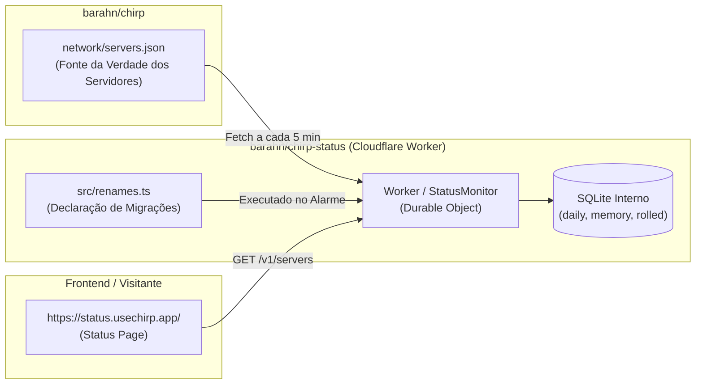
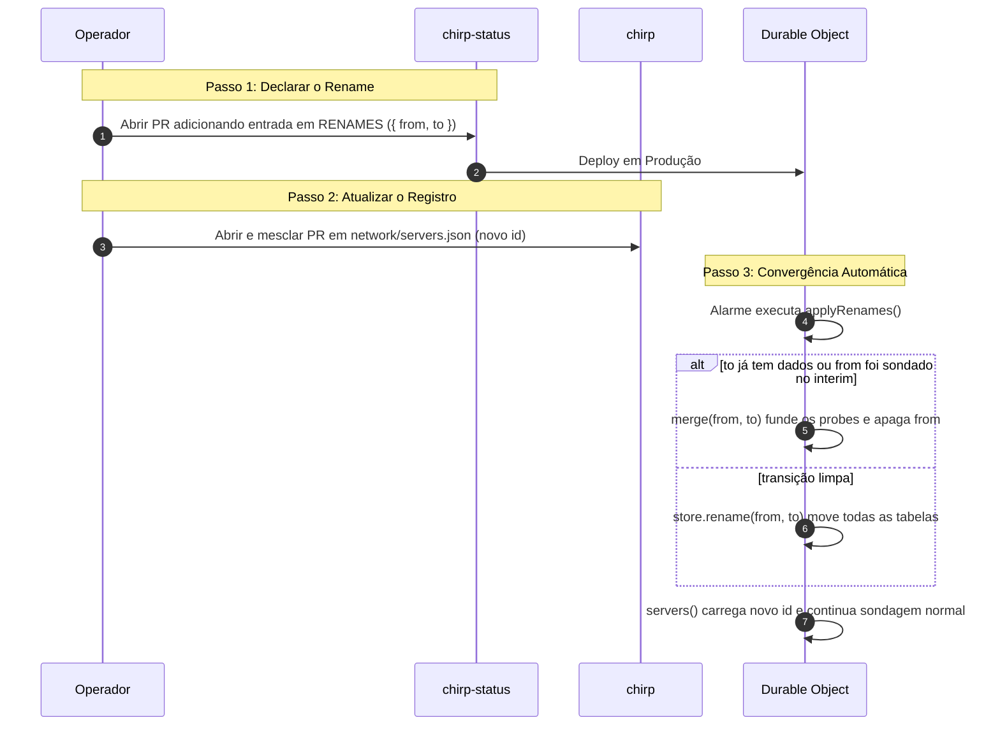

# Relatório Pós-Incidente: Colisão de Renomeação e Sincronização de Servidores

**Data do Incidente:** 20 de Outubro de 2026  
**Serviço Afetado:** Monitor de Status Chirp ([status.usechirp.app](https://status.usechirp.app/))  
**Componentes Envolvidos:** Cloudflare Workers Durable Object (`StatusMonitor`), Repositório [barahn/chirp-status](https://github.com/barahn/chirp-status) e Repositório [barahn/chirp](https://github.com/barahn/chirp)  
**Status Final:** Resolvido (zero perda de dados de uptime, renomeação concluída e validada)

---

## 1. Resumo Executivo

Após o merge do **PR #11** no repositório `barahn/chirp-status`, a página de status continuou exibindo o identificador antigo `pve-dc-01` e os logs de alarme da Cloudflare passaram a registrar o seguinte erro:

```json
{
  "level": "error",
  "message": "chirp-status: rename pve-dc-01 -> bradador-vector: cannot rename \"pve-dc-01\" to \"bradador-vector\": \"bradador-vector\" already has a record"
}
```

Duas causas raízes interdependentes foram identificadas:
1. **Dessincronização entre repositórios:** O `chirp-status` busca a lista ativa de nós em `network/servers.json` no repositório `barahn/chirp`. O **PR #157** em `barahn/chirp` (que atualizava o id para `bradador-vector`) ainda não havia sido mesclado.
2. **Corrida e recriação de registros no Durable Object:** A declaração de rename em `src/renames.ts` rodou imediatamente no primeiro ciclo de alarme e moveu todo o histórico do banco de `pve-dc-01` para `bradador-vector`. Logo após, o monitor consultou a lista remota (que ainda continha `pve-dc-01`), executou o probe e criou um novo registro para `pve-dc-01`. Nos ciclos seguintes, o `applyRenames` encontrou ambos os IDs preenchidos e falhou porque `Store.rename` recusava sobrescrever destinos já existentes.

A solução consistiu em implementar em `chirp-status` a capacidade de **fusão (merge)** de estados divididos (absorvendo as medições recentes e removendo o ID legado) via **PR #14**, seguido pelo rebase e merge do **PR #157** no repositório `chirp`. Todo o histórico desde 15/10/2026 foi preservado com 100% de integridade.

---

## 2. Arquitetura e Contexto

O ecossistema divide as responsabilidades em dois repositórios complementares:



- **`daily`**: Totais consolidados de dias anteriores (uptime observado e mediana de latência).
- **`memory`**: Estado em curso do dia atual (mapa minuto a minuto, últimas amostras para cálculo de veredito `up/down`).
- **`rolled`**: Índice do último dia consolidado em `daily`.
- **`RENAMES`**: Lista declarativa de servidores renomeados (`from -> to`).

---

## 3. Linha do Tempo do Incidente

| Horário (UTC) | Evento |
|---|---|
| **19:08** | Merge do PR #11 (`feat: a nickname for every server, and a rename that keeps the record`) em `barahn/chirp-status`. |
| **19:26** | Deploy do Worker em produção na Cloudflare. |
| **19:26:05** | Primeiro alarme do Durable Object: `applyRenames()` move as tabelas SQLite de `pve-dc-01` para `bradador-vector`. |
| **19:26:06** | No mesmo ciclo, `servers()` busca `network/servers.json` em `barahn/chirp/main` (que ainda continha `pve-dc-01`). O monitor executa o probe e recria uma linha de memória para `pve-dc-01`. |
| **19:28:35** | O Durable Object reinicia/executa alarme: `applyRenames()` roda novamente, encontra `has("pve-dc-01") == true` e `has("bradador-vector") == true`. `Store.rename` lança exceção: `"bradador-vector" already has a record`. |
| **19:30** | Usuário reporta que a página continua exibindo `pve-dc-01` com histórico zerado/recente e o erro da Cloudflare nos logs. |
| **19:41** | Identificada a causa raiz: PR #157 pendente no `barahn/chirp` e falta de mecanismo de convergência para o estado bifurcado no Worker. |
| **19:43** | Criado PR #14 no `chirp-status` implementando `merge()` de memórias e remoção limpa do ID antigo. |
| **19:45** | PR #14 aprovado e mesclado em `chirp-status/main`. |
| **19:47** | Deploy do PR #14 concluído na Cloudflare. No primeiro ciclo do novo código, o estado de `pve-dc-01` é mesclado em `bradador-vector` e `pve-dc-01` é excluído do SQLite. Erro cessa nos logs. |
| **19:56** | PR #157 atualizado com rebase e mesclado em `barahn/chirp/main`. |
| **20:01** | Cache do GitHub CDN (TTL 300s) e cache de 5 min do Worker expiram. O Worker carrega o novo `servers.json`. |
| **20:01:52** | API `/v1/servers` passa a responder `bradador-vector` com todo o histórico recuperado (1153 min observados hoje, 3309 min nos últimos 90 dias). |

---

## 4. Análise de Causa Raiz

### Falha 1: Dependência de Ordem Operacional sem Bloqueio Sistêmico
O PR #157 de `barahn/chirp` trazia na sua descrição:
> *"1. Merge barahn/chirp-status#11; 2. Merge this one. The declaration is idempotent and harmless while the registry still says pve-dc-01 — it simply finds nothing to move until this lands."*

A suposição de que a declaração seria inofensiva enquanto o registro dissesse `pve-dc-01` era incorreta. O código original de `applyRenames()` apenas verificava `store.has(from)`. Como `pve-dc-01` já existia no banco com medições desde 15/10/2026, ele foi movido de imediato, mesmo sem a nova lista ter entrado em vigor.

### Falha 2: Incompatibilidade entre Sondagem e Destino Movido
Como o arquivo `servers.json` continuava declarando `pve-dc-01`, a cada rodada de 30 segundos o monitor continuava enviando requisições HTTP para `https://relay.usechirp.app` sob o nome `pve-dc-01`. Isso gerou um estado bifurcado:
- `bradador-vector`: continha os dias consolidados anteriores (`daily`) e a memória até as 19:26.
- `pve-dc-01`: continha a nova memória de amostras das 19:26 às 19:47.

### Falha 3: Inflexibilidade no Tratamento de Colisão de Rename
O método `Store.rename(from, to)` possuía a guarda:
```ts
if (this.has(to)) {
  throw new Error(`cannot rename ...: ${to} already has a record`);
}
```
Essa regra foi pensada para impedir que dois servidores distintos acidentalmente sobrescrevessem seus registros. Porém, no contexto de um rename declarado pelo operador, se ambos os IDs possuíam dados, a exceção bloqueava a conclusão da migração e impedia que o ID legado fosse limpo, travando o sistema em um loop de erro a cada reinicialização da Durable Object.

---

## 5. Soluções Técnicas Implementadas

### A. Mecanismo de Convergência e Fusão em `chirp-status` ([PR #14](https://github.com/barahn/chirp-status/pull/14))

Modificamos `src/store.ts` e `src/monitor.ts` para suportar fusão segura:

1. **`copyTotals(from, to)` e `drop(id)` no `Store`**:
   Permitem copiar dias fechados via `INSERT OR IGNORE` e apagar de forma transacional todas as tabelas com chave `server_id = id`.

2. **`Monitor.rename()` com detecção de colisão**:
   ```ts
   rename(from: string, to: string): boolean {
     if (from === to) return false;
     if (!this.store.has(from)) return false;
     if (this.store.has(to)) {
       // Ambos existem: funde o estado recente do probe em 'to' e descarta 'from'
       this.merge(from, to);
       return true;
     }
     const moved = this.store.rename(from, to);
     this.mem.delete(from);
     this.mem.delete(to);
     return moved;
   }
   ```

3. **`Monitor.merge(from, to)`**:
   - Decodifica o JSON de memória de ambos os IDs.
   - Combina as contagens minuto a minuto (`ok` e `failed` por vantage point).
   - Concatena as latências do dia.
   - Concatena as amostras recentes (`recent`) mantendo ordenação temporal até o limite de buffer.
   - Atualiza `lastOK` para a marca mais recente.
   - Salva a memória unificada em `to`.
   - Executa `store.drop(from)` e invalida os caches em memória.

### B. Atualização do Registro Oficial ([barahn/chirp#157](https://github.com/barahn/chirp/pull/157))

O PR #157 foi rebaseado com os commits recentes da `main` de `chirp` e mesclado. O arquivo oficial agora aponta diretamente para o novo ID:
```json
{
  "servers": [
    {
      "id": "bradador-vector",
      "kind": "node",
      "url": "https://relay.usechirp.app",
      "operator": "Fabrintek",
      "github": "mendsec",
      "region": "BR",
      "behind_cdn": false,
      "added": "2026-10-15"
    }
  ]
}
```

---

## 6. Procedimento Recomendado para Renomeações Futuras

Para evitar qualquer discrepância em renomeações futuras na rede Chirp:



1. **Ordem de Merges:** É preferível mesclar o PR em `chirp-status` primeiro (para que a regra de migração já esteja em produção) e, em seguida, mesclar o PR em `chirp` logo em sequência.
2. **Resiliência Nativa:** Graças à implementação do `merge()`, mesmo se houver atraso de horas ou dias entre o merge de `chirp-status` e o de `chirp`, o monitor não quebrará: qualquer histórico antigo e sondagens recentes convergem automaticamente sem perda de uptime e sem poluição de logs.
